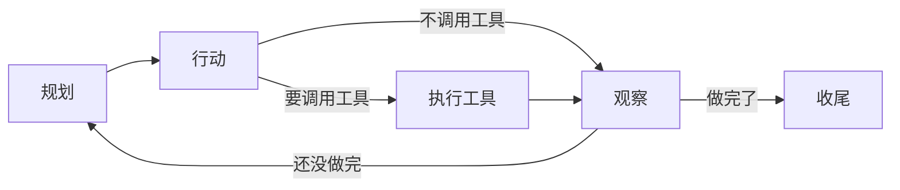

# SanYuanAgent 框架架构

> 状态：规划稿（2026-11-17）。「已有」指在原仓库（iClaw 的 Python Agent 引擎，原名 NeuroAgent）里已经实现。第 11、12 节是规划。

## 1 边界

SanYuanAgent 负责智能体怎么想、怎么做：理解意图、规划、调用工具、记忆、在沙箱里执行、选择模型、编排多个 Agent。

它不负责：

- 用户、租户、角色、权限这些业务主数据，那在 Kun。
- 界面，那在 Qian。
- Agent 与 Agent 之间往来的转交与审核，那是 Kun 的协同服务；引擎只负责收发，并且只执行人批准过的内容。

## 2 分层

| 层 | 内容 | 依赖 |
|---|---|---|
| 核心 | 推理循环、工具、技能、记忆、沙箱接口、模型供应方、编排、事件流定义 | 不依赖服务层，可以单独安装运行 |
| 服务层 | 对外的服务接口：对话与运行、流式输出、工作流、模型治理、技能同步、用量记账、工作区 | 依赖核心 |
| 媒体适配层 | 多模态能力的统一封装，先做了语音合成 | 独立的包 |

两条由测试强制的规矩：服务层可以引用核心，核心不得引用服务层；核心必须能在一个干净的环境里单独安装并运行。

## 3 推理循环

循环建在状态图上：

- 状态里有消息、工具结果、迭代次数与上限、感知记忆与工作记忆、累计用量。
- 工具调用失败不会让运行崩掉：失败以结果的形式回到模型，由它决定下一步；连续失败有熔断。
- 一个 Agent 用一份声明来描述：提示、模型、工具集、策略。

## 4 工具与策略

- **工具注册表。** 所有工具登记在注册表里。一个工具的声明包括名字、调用入口、输入 Schema，以及一组不参与执行的元数据：类别、能力、副作用、需要的密钥、是否产出产物、策略提示。元数据给策略、界面和审计用。
- **提供方接口。** 一组工具可以作为一个提供方整体登记。
- **内置工具。** 网页检索与抓取、文件、终端、浏览器、多模态、技能执行。
- **MCP。** 引擎里有 MCP 客户端，把外部服务器的工具接进注册表。现在只有本地进程这一种传输，远程传输是规划。

每次工具调用先过两道检查：

| 检查 | 做什么 |
|---|---|
| 工具策略 | 每个 Agent 有一组按顺序匹配的规则，结果是允许、拒绝或需确认 |
| 高风险识别 | 识别破坏性的命令、磁盘写入这类危险操作，标成需确认 |

需要确认而没有得到确认的调用不会执行，模型收到的是「需要确认」的结果。让人在界面上确认、运行暂停后再恢复的完整流程是规划。

另有提示注入检测：对进入上下文的内容做检测，并把可疑的记录下来。

## 5 技能

- 技能是带 front matter 的 `SKILL.md`，写明名称、版本、描述、用到的工具和触发条件。
- 引擎自带的技能随发行版一起发布，视为可信。
- 自定义技能必须带签名。没有签名或者校验不过的技能处于待定状态，不会被加载。
- 加载是按需的：模型先看到技能目录，用到某个技能时才载入它的正文。
- 服务层按租户同步已经批准的自定义技能。

## 6 记忆

记忆分四层：

| 层 | 存什么 |
|---|---|
| 感知 | 最近的原始事件，只留最近一段 |
| 工作 | 这次任务里「规划、行动、观察」的历史；超出上限时，较早的步骤压缩成摘要 |
| 情节 | 每次会话的摘要 |
| 长期 | 沉淀下来的语义记忆，按范围隔离，用向量检索召回 |

每条长期记忆有两个互相独立的属性：

- **访问范围**：个人、团队、租户。
- **上下文层级**：个人、项目、会话。

召回只在允许的范围里做：个人的，加上当前项目的，加上当前会话的。记忆还可以投影成一份 Markdown 文件，方便人查看。

## 7 沙箱

Agent 产生的代码、终端命令和文件操作在沙箱里执行。核心只定义沙箱提供方的接口，后端可以换：

| 后端 | 用途 |
|---|---|
| 本地实现 | 开发时用 |
| 桌面本地沙箱 | 在用户自己的机器上受限地执行 |
| 云上沙箱 | 在集群里隔离执行，经服务层接入 |

## 8 模型

- 核心有一个模型供应方的注册表，可以配置按顺序回退的备选模型。
- 服务层做模型治理：先把请求按意图归到一个档位，再由档位选模型，租户可以覆盖默认的选择。
- 对上游模型的调用经过模型服务网关。
- 每次调用的用量和成本都记账。

## 9 多 Agent

已有的是「编排者到工作者」这一种形态：

- **子 Agent。** 一个子 Agent 在全新的、隔离的状态里运行，只把结论和用量交回去。
- **把子 Agent 当工具。** 一个工作者可以包装成工具，由编排者调用。
- **工作流。** 一件事分成几个阶段，每个阶段把工作项并发分给多个子 Agent，最后可以汇总。进度以事件的形式输出。
- **路由。** 一个请求走单个 Agent 还是走工作流，由服务端判断。

工作者之间不通信。Agent 与 Agent 之间对等的往来现在没有，见第 12 节。

## 10 运行、线程与事件流

- **运行。** 一次运行有排队、运行中、成功、失败、取消几个状态。
- **线程与消息。** 对话按线程组织，线程属于某个租户和账号。
- **事件流。** 运行过程以服务端推送的事件流输出，事件类型包括：步骤、工具调用、工具结果、执行、产物、消息增量、工具进度、计划、最终回答。Qian 的过程展示就是渲染这条事件流。
- **后台运行。** 工作流可以脱离连接在后台运行，客户端断开之后可以重新连上，从指定位置接着收事件。

## 11 对接平台

规划。

| 事项 | 做法 |
|---|---|
| 身份 | 引擎以 `agent` 主体运行，令牌由 Kun 签发，带委托链，写明代表哪个人 |
| 调用平台能力 | 从 Kun 的能力目录按范围取可用的能力，作为工具登记进注册表；每次调用都经过 Kun 的权限判定 |
| 取 Agent 表面 | 技能、子 Agent 定义、钩子、MCP 服务器声明从平台的插件树按范围取，取代引擎自己的同步机制 |
| 两道权限 | Kun 的强制执行点是第一道，引擎的工具策略是第二道，后者不能代替前者 |
| 审计与计量 | 引擎产生的审计事件与用量交给 Kun 统一留存 |
| 人的确认 | 需确认的工具调用、智能体生成的变更，经 Kun 的审核流程交给人，批准后运行恢复 |
| 用社区组件 | 社区的技能、子 Agent、MCP 声明经平台导入并校验之后，引擎按同样的方式加载 |

## 12 个人 Agent 与协同

规划，见平台总览的 [Agent 协同](https://github.com/CavaiLAB/jiangxin/blob/main/docs/04-agent-collaboration.md)。引擎这一侧要做的：

- 一个 Agent 的声明里加上它的主人与授权范围。
- 提供收发协同消息的工具。发出的消息交给 Kun 的协同服务；收到的消息只有经人批准的才进入上下文，并且带着限定范围的授权。
- 别的 Agent 发来的内容在引擎里始终按数据对待，不当指令执行。
- 审核的结果（批准、修改、驳回及理由）写进记忆，作为以后的依据。
- 一个人名下多个 Agent 之间的分派，沿用已有的编排。

## 13 待定

| 事项 | 说明 |
|---|---|
| 发行名、导入名、许可、是否公开 | 见[迁移与改名](migration.md) |
| Python 侧是否实现与后端同语义的插件运行时 | 现在可替换的地方是注册表与接口，够用；是否进一步统一成插件运行时，待定 |
| 业务服务放在哪里 | 会话、Agent 定义、技能登记、模型治理这些，现在一部分在引擎的服务层，一部分在原仓库的 C# 服务里。以后哪些留在引擎的服务层、哪些做成 Kun 的插件，待定。提议：主数据与治理进 Kun，运行与流式输出留在引擎 |
| 技能 front matter 的统一 | 见[迁移与改名](migration.md)第 5 节 |
