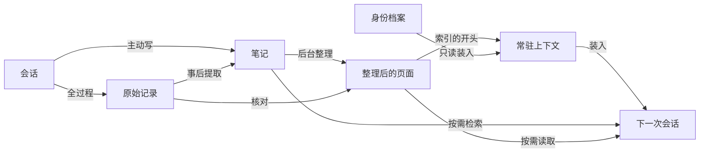

# 记忆的模型

> 状态：规划稿（2026-11-19）。已定的是第 1 节的两句话；第 2 节是现状；其余是提议，待产品负责人确认。「现状」说的是本仓库 `packages/core` 里的核心，对着代码核过；代码路径都在 `packages/core/sanyuan_agent/` 之下。服务层还没有迁入，本文不涉及。
>
> 本文参考了一篇公开的研究文章（2026-11）和一份对多家记忆方案的调研。那篇文章把智能体的记忆分成四级，并讨论了后台怎么整理。按文档的规矩不写它们的名字。

## 1 已定

产品负责人 2026-11-17 的要求：

1. 记忆要做到个人、团队、项目，以及短期、长期、稳定的身份信息。
2. 这里面是几个互相独立的维度：个人、团队、项目说的是归谁、谁能用；短期、长期说的是保存多久；事实、经历、技能说的是记住什么。

本文回答三个问题：现在的记忆离这两句话差在哪，见第 2 节；提议改成什么样，见第 3 至 6 节；先做什么，见第 7 节。

「会话」「运行」「轮」三个词的意思同[核心的差距与提议](core-gaps.md)第 1 节。「范围」指一条记忆归谁、谁能用。

## 2 现状

### 2.1 四层

核心里的记忆分四层，[框架架构](architecture.md)第 6 节有概述。

| 层 | 存什么 | 放在哪 | 谁写入 |
|---|---|---|---|
| 感知 | 最近的原始事件，缺省留 20 条 | 存储接口可以换，缺省在内存里 | 循环 |
| 工作 | 「规划、行动、观察」的步骤，带可选的摘要压缩 | 同上 | 循环 |
| 情节 | 每次运行一条：用户的输入、最终回答，外加少量统计 | 数据库 | 运行结束时由循环写 |
| 长期 | 一段文字和它的向量，带访问范围、上下文层级、重要度、可选的到期时间 | 数据库 | 模型调用记忆工具 |

四层都要调用方装配才生效。感知与工作两层要调用方放进运行状态，两层都在才记下工具步骤；核心自带的两处运行入口（本机桌面通道、子 Agent）没有放。情节层要调用方给出存储、租户标识和会话标识；长期层要给出存储和租户标识。

### 2.2 对照三个维度

| 维度 | 现在怎么表达 | 和要求的出入 |
|---|---|---|
| 归谁、谁能用 | 长期记忆上有两个字段：访问范围（个人、团队、租户）与上下文层级（个人、项目、会话） | 团队与项目的成员关系不在核心里；「会话」放在这一维里，它说的其实是时效 |
| 保存多久 | 感知与工作两层的存储缺省在内存里，留多久由调用方定；情节与长期两层持久。长期记忆的存储接口可以带到期时间，记忆工具写入时不设；检索时跳过已到期的。回收有两种：到期删除，超过容量时按重要度淘汰，都要调用方开启回收任务才执行 | 没有「被新的事实替代」「失效但留作历史」这两种；容量是按整个租户算的 |
| 记住什么 | 情节层是经历，长期层是事实，都是自由文本 | 经历只有一问一答，没有过程与证据；事实只增不改，没有去重与更新；做法不在记忆里，和技能没有联系 |
| 稳定的身份信息 | 没有 | |

### 2.3 写入与读取

- **写入只有两条路。** 情节在运行结束时自动存一条。长期记忆只有模型调用记忆工具才会写入，范围、层级、重要度由模型在调用时填（`memory/longterm/tools.py`）。没有事后的提取与整理。
- **装配了情节或长期记忆时，每一轮请求模型之前都检索。** 检索词是这次运行里用户的输入，结果各作为一条消息插在序列最前面（`agents/simple.py`）。到了轮数上限、收尾的那一次请求不检索。它对提示缓存的影响见[核心的差距与提议](core-gaps.md)第 3.6 节。
- **情节记录的键是租户与会话，不带用户标识。** 所以没有「这个人跨会话的经历」这种召回。
- **持久的两层只有数据库后端。** 还要调用方给出租户标识才工作；核心自带的本机桌面通道不给租户标识，也不装配这两层。本机的文件后端还没有，见[独立运行的 SDK](sdk.md)第 9 节。
- **检索方式。** 情节用关键词，或者本机的嵌入模型；长期用向量。
- **只读的投影。** 长期记忆可以投影成一份 Markdown 文件，按个人、项目、会话分节，一条一行（`memory/projection.py`）。

## 3 提议：每条记忆带四个属性

提议每条记忆都带四个属性，互相独立。前三个就是第 1 节的三个维度；第四个是为稳定的身份信息加的。

| 属性 | 回答什么 | 取值 |
|---|---|---|
| 范围 | 归谁、谁能用 | 个人、团队、项目、全租户 |
| 时效 | 保存多久 | 短期、长期 |
| 内容 | 记住什么 | 事实、经历、做法 |
| 来源 | 凭什么信 | 权威、明说、整理、推断 |

### 3.1 范围

- 一条记忆只归一个范围，带着这个范围的标识：哪个人、哪个团队、哪个项目。个人的，只有本人的 Agent 能用；团队的、项目的，成员的 Agent 能用；全租户的，租户里的 Agent 都能用。
- 同一个人名下有多个 Agent 时，个人范围的记忆它们都能读，每条记下是哪个 Agent 写的。这一条待定，见第 8 节。
- 「我在某个项目里的约定」这类内容归个人，另外标上它适用的项目。现在的「访问范围是个人、上下文层级是项目」表达的就是这个，保留。
- 「会话」不再是范围的取值。只在一次会话里有用的内容属于短期，见第 3.2 节。
- 全租户这一档第 1 节没有提到，对应现在的「租户」，提议保留。它放的是全组织的规则，只由指定的人维护。
- 谁是哪个团队、哪个项目的成员，不由引擎判断，见第 5 节。

### 3.2 时效

- **短期**是工作状态：现有的感知与工作两层，加上只在这次会话里有用的笔记。它最长留到会话结束。要留的东西由会话日志留着；会话日志本身还是提议，见[核心的差距与提议](core-gaps.md)第 3.1 节。
- **长期**跨会话保存。一条长期记忆当前有效，直到被替代、失效、到期或删除。

长期记忆的更新与遗忘，提议分清六种行为。

| 行为 | 对这条记忆 | 历史 |
|---|---|---|
| 合并 | 重复或互补的几条并成一条 | 原来的几条留作依据 |
| 替代 | 新的事实成为当前值 | 旧的那条记下失效的时间，仍然可以按当时的情况查到 |
| 失效 | 这件事不再成立，也没有新值 | 留作历史 |
| 衰减 | 只降低检索时的排序 | 不变 |
| 到期 | 过了设定的时间就不再返回 | 记录还在，之后按策略清理 |
| 删除 | 移除这条记录 | 由它派生的索引、向量、整理页里的引用一并清掉；原始记录按它自己的保留策略处理 |

另外两点：

- 每条事实带两个时间：这件事什么时候成立，什么时候被记下。项目的一条约束可以长期保存，同时在项目换了阶段之后失效。
- 容量按范围算，不按整个租户算。

### 3.3 内容

| 内容 | 例子 | 怎么处理 |
|---|---|---|
| 事实 | 人的偏好、项目的技术栈、客户的业务事实 | 一条只记一件事，写明说的是谁或什么。新的证据可以替代旧的事实 |
| 经历 | 一次故障怎么处理的、一次会议定了什么 | 记下目标、结果、关键的决定、参与的人，并指回会话日志。只追加，不改写 |
| 做法 | 发布的流程、排障的步骤 | 笔记里记的是心得；成品是技能，带版本，经过校验与批准之后才共享。见[核心的差距与提议](core-gaps.md)第 3.10 节 |

第 1 节说的「技能」对应这里的「做法」。在本仓库里「技能」专指 `SKILL.md` 形式的那种文件，所以记忆这一侧换了一个词。

记忆之外，组件里新增了一种「知识库」内容（已定，平台总览的 [2026-11-19 平台级裁定](https://github.com/CavaiLAB/jiangxin/blob/main/docs/decisions/2026-11-19-platform.md) P30）：一批资料连同它的整理方式。它的格式、由谁存放与检索还没有定，提议见平台总览的[一切皆插件](https://github.com/CavaiLAB/jiangxin/blob/main/docs/03-plugin-model.md)第 3、9 节；本文不涉及。

### 3.4 来源

| 来源 | 含义 |
|---|---|
| 权威 | 出自主数据所在的系统，比如平台里的身份。Agent 不能写 |
| 明说 | 当事人明确说过，或者写在他自己维护的文件里 |
| 整理 | 后台整理从多条笔记里得出，带着指向那些笔记的链接 |
| 推断 | Agent 从交互里推断出来的 |

- 四档从高到低：权威、明说、整理、推断。
- 两条事实冲突时先比来源，来源相同再比新旧。来源低的不覆盖来源高的。
- 除了权威的，每条记忆都带证据：指回会话日志里的一段，或者指回出处文件的某个版本。后台整理靠它核对笔记有没有记错。
- 更正不算冲突。笔记和它的证据对不上，是记错了，按证据改，不受来源高低的限制。
- 内容出自不可信的输入的，要标出来，比如网页、工具结果、外部消息。这类记忆不经人审不能进共享范围，见第 5.2 节。

### 3.5 稳定的身份档案

提议不把稳定的身份信息当成第三种时效。它是长期的事实，来源是权威，结构固定：姓名、账号标识、角色、所属的组织这一类字段。它和别的长期记忆的区别不在保存多久，而在谁说了算。「稳定」说的是变化少，不是不可变。

- 接入平台时，档案从平台的身份读取。引擎只缓存、只读，不把它当成第二份主数据。平台的边界规则是业务主数据只有一份、在 Kun，见平台总览[总体架构](https://github.com/CavaiLAB/jiangxin/blob/main/docs/02-architecture.md)第 2 节。
- 独立运行时，档案是本机的一份文件，由人维护。
- Agent 不能改档案。会话里出现的称呼、偏好另存为「明说」或「推断」的事实，不覆盖档案。账号里的正式姓名、聊天里的称呼、角色扮演里用的名字可以同时存在，它们不是同一个事实的冲突。
- 档案的字段会变，比如换了岗位。变更从权威来源来，按「替代」处理，旧值留作历史。

## 4 提议：记忆分四级

参考的研究把记忆分成四级，原始记录是核对上面各级的依据。提议照这个分法，把核心的记忆对上去。现有的记忆已经叫「四层」，所以这里的叫「级」。

| 级 | 放什么 | 核心现在 | 要做的 |
|---|---|---|---|
| 原始记录 | 会话的全过程，可以检索，是判断笔记对错的依据 | 没有。情节层只有一问一答 | 就是[核心的差距与提议](core-gaps.md)第 3.1 节的会话日志，不另建 |
| 笔记 | 一条条带四个属性的记忆 | 长期层，只有模型主动写 | 会话中少量主动写，加上事后从记录里提取 |
| 整理后的页面 | 每个范围一组页面：一个实体一页，外加一份索引 | 只有一份只读的投影 | 由后台整理维护 |
| 常驻上下文 | 身份档案，加上各个可见范围的索引开头的一小段，有上限 | 没有 | 会话开始时装入，记忆视图不变就不动，见第 4.3 节 |

现有的四层对到这里：

| 现有的层 | 提议里 |
|---|---|
| 感知、工作 | 短期的工作状态，不在这四级里，见第 3.2 节 |
| 情节 | 由原始记录取代；值得留的经历另成一条笔记 |
| 长期 | 成为笔记这一级，补上四个属性 |

参考的研究把三样东西排除在外：模型权重的变化、一次会话之内学到的东西、上下文压缩。这四级说的是跨会话留下来的东西；会话之内的归短期，见第 3.2 节。压缩见[核心的差距与提议](core-gaps.md)第 3.6 节。

### 4.1 写入

- **会话中主动写，要少。** 只在人要求记住，或者明显值得记住的时候写。写入占主任务的注意力。
- **范围不由模型随意填。** 记忆工具缺省写进个人范围；别的范围是可以直接写、只能提议还是不能写，由这次运行的记忆视图决定，见第 5 节。来源与证据由引擎填：人要求记住的是「明说」，其余是「推断」。
- **事后提取。** 运行结束之后，从会话日志里提取事实、经历的摘要、做法上的心得。这一步不占主循环。它就是[核心的差距与提议](core-gaps.md)第 3.10 节的复盘里记忆的那一半。
- **不记能直接从环境读到的东西。** 设备此刻的状态、文件此刻的内容，用的时候去读，不进记忆。进记忆的是人说过的话，和要推理才能得到的结论。参考的研究在一项实验里有同样的观察：随时读得到的状态，记下来是多余的。
- **指引按模型的强弱分两套。** 参考的研究在一项评测里看到：对较新的模型，让它自己判断什么值得记，比定死规则有效；对较早的模型，明确的引导帮助最大，比如先读记忆再回答。本文把这一条推到小模型上：设备上可能是小模型，见[与模型服务的交互](models.md)，所以提议两套都要有。

### 4.2 后台整理

事后提取只看刚结束的那一次运行。后台整理看的是跨会话积累下来的笔记，按节奏做。

做的事：

1. 对照会话日志核对笔记，改掉记错的。
2. 合并重复的，把过时的事实按「替代」或「失效」处理。
3. 维护页面与索引：一个实体一页，关键的原话照抄；细节往下放，上层只留链接。
4. 跨会话找反复出现的做法和反复犯的错，写成心得；够格的出技能草稿。技能草稿照[核心的差距与提议](core-gaps.md)第 3.10 节的规矩走，一律等人批准。

提议：

- **出新版本，不原地改。** 每次整理产出一个新版本，可以看差异，可以回滚。
- **个人范围的提取与整理自动生效，共享范围的要批准。** 见第 5.2 节与第 8 节。
- **节奏按用得多少来定。** 常被读到的、容易变的内容优先整理，不是每次都把全部记忆过一遍。触发方式见[核心的差距与提议](core-gaps.md)第 3.9 节。
- **可以交给便宜的模型做。**

整理有两件事要防。一是页面越写越细：参考的研究里有一个例子，整理出的页面比原始材料还长，等于没有提炼。二是错误在维护过程里累积，参考的研究也提醒要避免。所以页面要有长度上限，整理要回到会话日志核对。

### 4.3 读取

- **常驻上下文在会话开始时装入。** 按当时的记忆视图装，有上限。之后的运行里视图没变就不动它，这样它可以排在提示的稳定前缀里，见[核心的差距与提议](core-gaps.md)第 3.6 节。视图变了，就按新的视图重装一次。
- **其余按需检索。** 记忆工具在可见的范围里检索笔记、读页面。没有嵌入模型的设备上先用关键词与时间，有了再开向量，见[与模型服务的交互](models.md)第 10 节。
- **结果带着属性返回。** 每条结果标出范围、来源、成立的时间。模型据此掂量该信多少。
- **检索是底座，整理是补充。** 参考的研究在一组规模不大的问答上看到：只靠整理出的页面作答不如直接检索，两者一起最好。所以提议先做会话日志、检索和一份精简的索引，页面的整理放在后面，评测过再投入。
- **每轮之前自动检索的做法改掉。** 现在的做法见第 2.3 节。缺省改成按需检索。给弱的模型可以开一个选项：每次运行开头检索一次，结果追加在消息序列的后部，不动前缀。

## 5 提议：范围怎么判定

### 5.1 记忆视图

每次运行开始时，调用方给出一张记忆视图：这次运行能看到哪些范围，每个范围是只读、可提议还是可写。

- 记忆的存取都经过这张视图。模型不能自己指定范围。
- 接入平台时，视图经平台连接器向 Kun 取，依据是身份与成员关系；独立运行时来自本机配置。
- 引擎不保存成员关系。平台的分工里写明引擎不另存一套用户、租户、权限，见平台总览[总体架构](https://github.com/CavaiLAB/jiangxin/blob/main/docs/02-architecture.md)第 2 节。
- 人看得见、改得了。个人可以查看、改正、删除自己范围里的记忆；共享范围的由负责人维护。

### 5.2 往共享范围写入

团队、项目、全租户是共享范围：一个 Agent 写进去的内容，会进入别的 Agent 的上下文。平台的协同规则里有一条：Agent 不能把内容直接写进别的 Agent 的上下文，见平台总览 [Agent 协同](https://github.com/CavaiLAB/jiangxin/blob/main/docs/04-agent-collaboration.md)第 3 节。往共享范围写记忆做的正是这件事，所以要同样对待。

提议：

- 个人范围，Agent 可以直接写。
- 共享范围，Agent 只能提交提议，该范围的负责人批准之后才生效。在记忆视图里，共享范围最多是「可提议」。起步阶段一律如此。
- 共享范围的内容进入上下文时，标明它的范围与来源。它是数据，不是指令。
- 写入与批准都留痕：谁、什么时候、依据的是哪段记录。

不这样做，一条被污染的记忆会一直留在共享范围里，每次会话都被装进去。

### 5.3 独立运行时

独立运行时没有租户，也没有团队。

- 个人范围就是这台设备上的这个使用者。
- 项目范围是当前的项目目录。项目记忆是目录里的文件，可以随代码仓库走，评审走代码评审。
- 身份档案是本机的一份文件。

接入平台是加法：多出团队与全租户两个范围，多出由平台判定成员的项目；个人范围对应到平台上的这个人。目录里的项目记忆照旧可用，它和平台上的项目怎么对应，待定，见第 8 节。这和[独立运行的 SDK](sdk.md)第 2 节「接入平台是加法」是同一条。

### 5.4 需要平台提供的

下面几件是平台级的事，要在平台总览里定。这里只列出引擎需要什么：

- 团队与项目这两类实体，以及各自的成员关系与负责人。
- 共享记忆的提议由谁审、在哪里审。可以沿用协同消息的人审流程。
- 身份档案有哪些字段，引擎怎么取。
- 审核的结果回到记忆。平台总览 [Agent 协同](https://github.com/CavaiLAB/jiangxin/blob/main/docs/04-agent-collaboration.md)第 4.4 节已经写了这一条。按本文的分法，它是一条经历，来源是「明说」。

## 6 提议：存放

- **本机是一个目录。** 每个范围一个子目录，里面是档案、索引、页面、笔记和检索用的索引。页面与索引是 Markdown，人可以直接看。这和[独立运行的 SDK](sdk.md)第 5 节「一个目录装下全部状态」「记忆有本机后端」是同一件事。
- **集群里仍然用数据库。** 两种后端在同一个接口后面。
- **现有的只读投影不再需要。** 整理后的页面本身就是给人看的那一份。
- **带版本，写入带条件。** 多个写入者同时改一页时，后写的要先确认自己看到的是最新的内容，否则重读再写。
- **向量是可选的。** 同一个记忆库里的向量要出自同一个嵌入模型，见[与模型服务的交互](models.md)第 10 节。
- **设备与平台之间要不要同步，仍然待定。** 见[独立运行的 SDK](sdk.md)第 4 节。

## 7 先后

1. **定模型与契约。** 一条记忆的字段、记忆视图、更新与遗忘的六种行为。这一步不动行为，可以先做。笔记的证据指向会话日志，所以这份契约要和会话日志的契约一起定，见[核心的差距与提议](core-gaps.md)第 3.1 节。
2. **存取收口，补本机后端。** 存取都经过记忆视图；加本机的文件后端；身份档案只读装入；每轮自动检索改成会话开始时装入常驻上下文，其余按需检索。
3. **事后提取与后台整理。** 依赖会话日志、定时与事件触发、复盘，见[核心的差距与提议](core-gaps.md)第 3.1、3.9、3.10 节。
4. **团队与项目的共享。** 依赖第 5.4 节那几件平台级的事。

第 2 步起是对核心行为的改动。过渡期能不能先在本仓库改核心的行为还是待定，见[迁移与改名](migration.md)第 2 节。

评测跟着每一步走：召回得对不对，被替代的事实是不是不再返回，有没有把一个范围的内容给了另一个范围，每次会话多花多少。评测的形态见[核心的差距与提议](core-gaps.md)第 3.8 节。

## 8 待定

前四行是对第 1 节那两句话的细化或改动，请先看。

| 事项 | 提议 |
|---|---|
| 第 1 节的「技能」在记忆这一侧用哪个词 | 叫「做法」，成品仍然是技能，见第 3.3 节 |
| 稳定的身份信息算不算第三种时效 | 不算。它是来源为权威的长期事实，见第 3.5 节 |
| 要不要在三个维度之外加「来源」这个属性 | 要，见第 3.4 节 |
| 要不要「全租户」这一档、由谁维护 | 要，对应现在的「租户」；由指定的人维护 |
| 团队与项目的成员关系放在哪 | 放在平台，引擎只问不存。平台总览里还没有这两类实体 |
| 往共享范围写记忆要不要人审 | 要。起步阶段一律审 |
| 身份档案以谁为准 | 接入平台时以平台的身份为准，引擎只读 |
| 同一个人名下的多个 Agent 是否共用个人记忆 | 共用，都可以读；各写各的，记下是哪个 Agent 写的 |
| 个人范围的事后提取与后台整理要不要人批准 | 不要，自动生效，可以回滚。技能草稿不在此列 |
| 会话中主动写的记忆，来源算哪一档 | 人要求记住的算「明说」，其余算「推断」 |
| 独立运行时目录里的项目记忆，接入平台后怎么对应平台上的项目 | 没有提议 |
| 设备与平台之间要不要同步记忆 | 没有提议，见[独立运行的 SDK](sdk.md)第 4 节 |
| 记忆的字段契约放在哪 | 和会话日志的契约放在一起 |
| 原始记录保留多久、谁能看 | 没有提议。它比笔记敏感，要单独定 |
