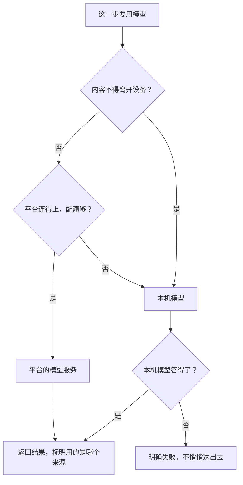

# 与模型服务的交互

> 状态：规划稿（2026-11-17）。已定的是第 1 节的两句话，其余是提议，待产品负责人确认。「已有」指在原仓库里已经实现。

## 1 已定

产品负责人 2026-11-17 的裁定：

1. 模型服务由 Kun 提供。
2. 机器人这类设备本地可能还有小模型。

所以引擎面对的模型不止一个来源，哪个来源可用还会随着网络变。本文回答引擎怎么把它们一起用好。

## 2 三个来源

| 来源 | 在哪里 | 特点 | 什么时候用 |
|---|---|---|---|
| 平台的模型服务 | 由 Kun 提供，在云上或厂内机房 | 模型大、能力全；有配额与计量；要联网 | 接入平台时的主要来源 |
| 本机模型 | 设备上的小模型，由设备上的推理运行时提供 | 时延低、数据不出设备、断网可用；能力有限 | 断网时；数据不能出设备时；对时延敏感的小步骤 |
| 直连的端点 | 使用者自己配的模型端点 | 不经过平台 | 只在独立运行时用 |

接入平台之后不再用第三种。要用别家的模型，把它登记到平台的模型服务里，由平台统一计量与管控。本机模型是例外，它不经过平台，见第 7 节。

## 3 一种协议

三个来源对引擎来说是同一种东西：一个兼容 OpenAI 接口的端点，加上一份能力描述。

- 平台的模型服务对外提供这种接口，这是 Kun 的规划。
- 设备上的推理运行时大多也提供这种接口。引擎把它当成本机地址上的一个端点。
- 引擎现有的模型供应方就是这么接的：一个供应方是一个端点加一处取密钥的位置，可以配置按顺序回退的备选（已有）。

引擎不自带模型，也不自带推理运行时。设备上用什么运行时、跑什么模型由设备一侧决定，引擎只约定怎么接。

## 4 模型目录

引擎运行时手里有一份模型目录。每一项说明：

| 字段 | 含义 |
|---|---|
| 逻辑名 | Agent 声明里引用的名字。它是用途槽位，比如缺省对话、缺省嵌入，不写死是哪个模型 |
| 来源 | 平台、本机或直连 |
| 能力 | 模态、是否支持工具调用、上下文长度 |
| 档位 | 时延和成本各在哪一档 |
| 数据去向 | 数据会不会离开设备、离开厂区 |
| 状态 | 现在可用不可用 |

- 接入平台时，目录由 Kun 的模型服务下发，引擎再把探测到的本机模型并进去。目录缓存在本机，断网时照用。
- 独立运行时，目录就是本机配置。
- 模型能力怎么描述，沿用已有的模型能力契约，不另起一套。

## 5 路由：这一步用哪个模型

Agent 的声明只说要什么，不说用哪个：

- 用途或档位：快速响应、深入思考、嵌入。
- 约束：必须支持工具调用、要看图、数据不得离开设备、时延上限。

缺省的路由是平台优先、本机兜底：

路由策略依次看四件事：

1. **约束。** 标了不得离开设备的内容只在本机模型上跑。没有合适的本机模型就明确失败，不悄悄送出去。
2. **连通。** 平台不通或者超时，退到本机模型。
3. **配额。** 平台的配额用完时，退到本机模型还是停下，由策略定。
4. **任务。** 理解一句指令、选一个技能、抽几个参数这类小步骤，可以交给本机小模型；长规划、长上下文、多步推理交给平台的模型。这一条缺省不开，等有了实测数据再定。

策略从哪里来：独立运行时是本机配置；接入平台时由 Kun 的模型服务按租户、应用、Agent 下发，本机只能在它允许的来源里选。

## 6 模型变小了，Agent 要知道

小模型做规划和工具调用没有大模型可靠。退到本机模型时只换模型是不够的，引擎要跟着收紧：

- 只开放事先定好的一小组工具与技能。
- 步数的上限调低。任务拆不动就停下来报告，不硬做。
- 输出按结构化的格式约束，便于校验。
- 事件流里标明这一步用的是哪个来源的模型，事后分得清结果是在什么条件下得出的。

提议在 Agent 的声明里可以按模型的档位分别写工具集与上限。

## 7 凭据、计量与管控

| | 平台的模型服务 | 本机模型 |
|---|---|---|
| 凭据 | 用 `agent` 令牌，经 Kun 的网关调用。设备上不放模型供应方的密钥，也不放长期有效的模型密钥 | 本机地址，不需要平台的凭据 |
| 计量 | 平台在模型网关上计，按租户、应用、Agent 归属。以平台的数为准 | 引擎自己记，作为用量事件上报 Kun；断网时先存本机 |
| 配额与预算 | 平台管。超了返回结构化错误 | 不占平台的配额 |

本机模型不经过平台。这和现行的口径有出入：现行口径是模型调用都过模型网关，应用不许绕开它直连模型，为的是统一计量与隔离。设备上的本机模型过不了网关。

提议把它登记成一条明确的例外：只限设备本机地址上的模型；用量由引擎上报；平台在目录里看得到每台设备上有哪些本机模型。

## 8 本机模型从哪里来

待定。两种做法：

| 做法 | 说明 |
|---|---|
| 随设备预装 | 模型和推理运行时随设备的系统镜像装好。引擎只负责发现和使用 |
| 由平台下发 | 模型作为一种带版本、适用条件与签名的制品，由平台分发到设备 |

提议起步只做第一种。第二种牵涉模型的评测、发布与适用条件，属于工厂一级研发底座的范围，另行设计。

## 9 与感知、动作模型的边界

本文说的模型，是引擎的推理循环直接调用的语言模型与嵌入模型。

设备上还有另一类模型：识别工件、生成动作目标的那些。它们不由推理循环调用，在设备的感知与控制一侧，结果以工具结果或事件的形式进入引擎。这类模型算不算在引擎的范围里，仍然待定。

## 10 嵌入与记忆

长期记忆的向量检索要用嵌入模型。设备上有两种情况：

- 有本机嵌入模型：向量检索在本机做，断网可用。
- 没有：检索退到关键词与时间；联网时可以用平台的嵌入模型。

同一个记忆库里的向量要出自同一个嵌入模型，换模型就得重算。选来源的时候要把这一点算进去。

## 11 现状

已有：

- 模型供应方的注册表，可以配置按顺序回退的备选模型；遇到暂时性的错误会换下一个。
- 供应方可以指到任意兼容的端点。密钥从运行环境里取，不写进 Agent 的声明。
- 服务层的模型治理：请求按意图归到档位，由档位选模型，租户可以覆盖默认的选择。
- 对上游模型的调用经过模型服务网关；每次调用的用量和成本都记账。
- 嵌入可以用云上的，也可以用本机的。

没有：

- 模型目录与按约束的路由。现在的回退只按顺序，不看数据去向、连通状态和任务大小。
- 探测本机模型。
- 设备上用的模型凭据。现在的调用方都是服务端。
- 本机用量的上报与补传。
- 按模型的档位收紧工具集与步数。

## 12 待定

| 事项 | 提议 |
|---|---|
| 设备调用平台的模型走哪个入口 | 经 Kun 的网关，用 `agent` 令牌。不给设备发长期的模型密钥 |
| 本机模型作为「模型调用都过模型网关」的例外 | 登记为例外：限本机地址，用量由引擎上报 |
| 本机模型由谁装、谁管版本 | 起步随设备预装；由平台下发另行设计 |
| 引擎要不要自带一个缺省的推理运行时 | 不带 |
| 平台的模型服务先提供哪几类模型 | 先对话与嵌入；语音、重排、视觉按需再加 |
| 路由的缺省策略 | 平台优先、本机兜底；标了不得离开设备的只走本机 |
| 小步骤交给本机小模型要不要缺省开启 | 不开，等有了实测数据再定 |
| 产线的边缘节点上要不要放一份模型服务 | 没有提议，取决于边缘节点怎么定 |
