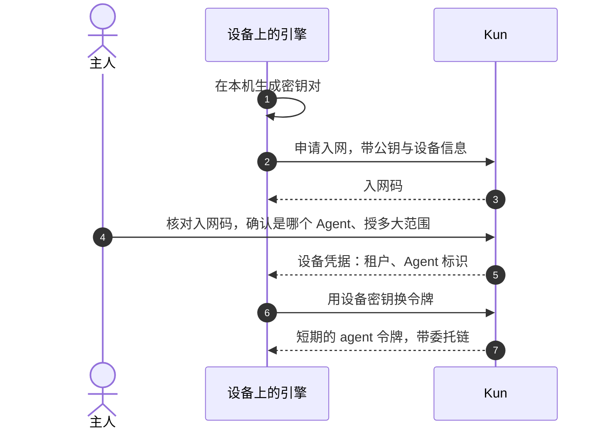

# 接入平台：与 Kun 的交互

> 状态：提议（2026-11-17），待产品负责人确认。本文说的能力都还没有实现。已定的前提见[独立运行的 SDK](sdk.md)第 1 节。Kun 一侧要提供什么，见 Kun 的[对智能体的支撑](https://github.com/CavaiLAB/kun/blob/main/docs/agent-support.md)。

## 1 原则

1. **不接平台也能跑。** 独立运行是缺省。接入平台是为了身份、权限、审计、协同和统一的模型服务，不是运行的前提。
2. **接了平台就以平台为准。** 身份、能调用什么、策略、审计的留存都听 Kun 的。本机配置只能收紧，不能放宽。
3. **设备只向外连。** 设备多半在车间网络里，外面连不进来。所有往来都由设备发起，Kun 不需要能连到设备。
4. **只认一个入口地址。** 设备只需要知道平台对外的一个地址。地址后面按平台现行的网关分层走两条路：入网、下发、上报、协同进 Kun 的网关；能力工具与模型调用进模型与 MCP 网关。两条路用同一种短期令牌，见第 6 节。
5. **断网尽量不停工。** 设备上有本机模型时，断网后本机该干的活照干；非要平台才能做的事明确失败或者排队，联网后补齐。设备上没有本机模型时，断网后引擎做不了新的推理，只把手上的事收尾，把记录存好。
6. **云上和设备上是同一套对接。** 集群里的服务层经同样的端口接 Kun，只是它一直在线。

## 2 接到哪里

设备只需要一个入口地址。它可以指向云上的平台，也可以指向产线边缘节点上的那一份。边缘节点上跑 Kun 是平台的规划，还没有定。

对引擎来说两者没有区别：同一套接口，同一种令牌。工站的设备就近接产线的节点，产线的节点再接工厂，是一种自然的落法，但这个对应没有经过确认。

## 3 入网与身份

一台设备上的引擎第一次接入平台，叫入网。

- **私钥不出设备。** 密钥对在设备上生成，平台只拿到公钥。
- **入网由主人本人批准。** 谁批准，谁就是这个 Agent 的主人。Agent 用的是主人的权限，所以不能由别人替他指定。批准时定下两件事：这台设备上跑的是哪个 Agent，授给它多大的范围。团队 Agent 由团队指定的负责人批准。
- **令牌是短期的。** 到期用设备密钥去续。吊销一台设备，就是不再给它续。
- **被拒绝和连不上是两回事。** 设备被吊销、委托被撤回或者主人被停用时，续令牌会被明确拒绝。引擎收到拒绝就停下受平台管的工作，丢掉缓存的授权，不按断网处理。连不上才按断网处理，见第 9 节。
- **委托是常设的。** 云上的 Agent 多半在某个人的会话里行事，委托人就是当时发起请求的人。设备上没有人坐在旁边，委托在入网时由主人批准一次，之后每次换令牌都按这份委托签发。主人被停用，或者委托被撤回，令牌就续不出来。

定义与主体是两回事：

| | 是什么 | 在哪里 |
|---|---|---|
| Agent 定义 | 声明加技能，作为组件分发 | 平台的目录里；装到设备上是一份副本 |
| Agent 主体 | 一个 `agent` 身份，有主人、名片、授权范围和自己的审计记录 | 每台设备入网之后各得到一个 |

同一份定义可以装到很多台设备上，比如一百个焊接工站跑同一个作业智能体。它们各是各的主体，出了事能查到是哪一台。

## 4 平台给设备什么

连接由设备发起：设备定期去取，并保持一条向外的长连接收通知。

| 内容 | 说明 |
|---|---|
| 令牌 | 短期的 `agent` 令牌 |
| Agent 表面 | 技能、子 Agent 定义、钩子、MCP 服务器声明，从平台的插件树按范围取。带签名，本机校验之后缓存 |
| 能力清单 | Kun 能力目录里这个 Agent 看得到的能力，以工具的形式给出 |
| 策略 | 工具策略、模型路由策略、断网时允许做什么 |
| 模型目录 | 有哪些模型可用、从哪里调，见[与模型服务的交互](models.md) |
| 任务与消息 | 经人审核过的协同消息，以及分派下来的任务，都带着限定范围的授权 |
| 确认的结果 | 人对确认请求的批准、修改或驳回 |

## 5 设备给平台什么

| 内容 | 说明 |
|---|---|
| 能力调用 | 调用平台的能力，经模型与 MCP 网关上的 MCP 路由。每次都经过 Kun 的权限判定并留审计 |
| 模型调用 | 调用平台的模型服务，经模型与 MCP 网关 |
| 审计事件 | 本机发生的事：调了哪个本机工具，用了哪个本机模型，人确认了什么 |
| 用量 | 本机模型的调用量。平台模型的用量由平台自己计 |
| 运行事件流 | 运行的过程，给界面展示用。报多细由策略定 |
| 协同消息与回执 | 发出去的消息，任务的结果 |
| 确认请求 | 要人确认的动作，交给 Kun 的审核流程 |
| 心跳 | 在不在线、什么版本、是否健康 |

## 6 调用平台的能力

- Kun 把能力目录按范围派生成 MCP 工具，这是 Kun 的规划。按来源仓库现行的决策，Agent 不直接连平台服务的地址，一律经模型与 MCP 网关上的 MCP 路由。
- 引擎用 MCP 的远程传输去接，把这些工具登记进自己的工具注册表。远程传输引擎现在没有，MCP 客户端也还没有接进运行路径，都要补上。
- 每次调用带 `agent` 令牌。令牌按受众签发，不透传：给一条路用的令牌不能拿去调另一条。判定在 Kun 的强制执行点做：有效权限 = 委托人的权限 ∩ 授给这个 Agent 的范围。标了「只许人做」的能力，Agent 看不到，也调不了。
- 出错是结构化的：错误码加机器可读的细节。引擎按错误码决定重试、换一条路还是停下，不去解析报错的文字。
- 引擎自己的工具策略照常生效。它是补充，不代替 Kun 的判定。

## 7 两类动作，两处约束

| 动作 | 例子 | 由谁约束 | 留痕 |
|---|---|---|---|
| 平台能力 | 查工单、报工、改排程 | Kun 的强制执行点，在服务端 | Kun 的审计 |
| 本机动作 | 调用设备的技能、读写本机文件、调用本机模型 | 引擎里的工具策略；接入平台时用平台下发的策略 | 引擎记录，再上报 Kun |

本机动作发生在设备上，平台不在现场，判定不了每一次调用。平台对本机动作能做的是三件事：事前下发策略，事后收审计，发现异常时吊销设备。这一点在设计里要讲明白，不能把它说成和平台能力一样的实时判定。

吊销也不是即时的。联着网的设备在下一次续令牌时被拒绝，随即停下。断着网的设备收不到拒绝，它会按缓存的策略干到宽限期结束：宽限期就是吊销对断网设备生效的最长延迟。

设备的安全联锁（急停、运动约束）在控制一侧，不依赖引擎，也不依赖平台。

## 8 人的确认与协同

- 要人确认的动作，接入平台时交给 Kun 的审核流程：运行暂停，人在界面上批准、修改或驳回，结果下发之后运行恢复。完整的暂停与恢复引擎现在还没有。
- 协同消息走 Kun 的信箱。设备上的 Agent 和云上的一样：发出的消息交给 Kun；收到的消息只有经人批准的才进入上下文。别的 Agent 发来的内容要按数据对待，不当指令执行。
- 工厂、产线、工站三级之间的任务分派要不要逐条人审，还没有定，见平台总览的 [Agent 协同](https://github.com/CavaiLAB/jiangxin/blob/main/docs/04-agent-collaboration.md)第 9 节。设备上的 Agent 跟不跟得上生产节拍，取决于这一条怎么定。

## 9 断网

| 事项 | 断网时 | 联网后 |
|---|---|---|
| 令牌 | 续不了，也用不上：平台本来就连不通 | 重新换令牌 |
| 策略、技能、能力清单 | 用本机缓存。缓存有宽限期，过期之后只做策略里标明「断网可做」的事。宽限期越长，吊销生效得越晚 | 刷新 |
| 已经下发的任务 | 接着做 | 上报结果 |
| 新任务与新消息 | 收不到 | 去取 |
| 平台能力 | 要即时结果的调用失败，返回明确的错误；只是上报的调用进本机队列 | 队列按顺序补发，用幂等键去重 |
| 模型 | 有本机模型就退到它，见[与模型服务的交互](models.md)；没有就做不了新的推理 | 恢复按策略路由 |
| 审计与用量 | 追加写在本机，带序号 | 补传。Kun 按序号看得出中间有没有缺 |
| 要人确认的动作 | 等着，或者按策略直接拒绝 | 送审 |

断网时引擎不猜：策略没说可以做的事不做，放不下的任务停下来等，不在本机自己放宽。续令牌被明确拒绝不算断网，见第 3 节。

## 10 云上的服务层

集群里的服务层走同一套端口。差别有四处：

- 身份由网关换发的内部令牌带进来，不需要入网。
- 一直在线，不需要补传的队列。
- 多租户：一个进程服务很多个 Agent 主体，每次运行按令牌切换身份与范围。
- 调模型与 MCP 网关时，它是可信的调用方，调用归到谁由它自己标注。设备不可信，归属要从校验过的令牌里取。

服务层现在与平台对接的那些部分，包括服务间认证、技能同步、审计上送、模型配置和配额，提议都改走这套端口，由平台连接器统一承担。

## 11 依赖 Kun 的什么

| Kun 的能力 | 现状 |
|---|---|
| `agent` 主体与委托链 | 契约已冻结，还没有启用 |
| 设备入网与设备凭据 | 没有，要新做 |
| 把能力目录派生成 MCP 工具 | 规划 |
| 按范围下发 Agent 表面 | 插件树与范围过滤已有；向设备下发是规划 |
| 下发策略 | 规划 |
| 接收设备上报的审计与用量 | 审计链已有；接收设备的补传是规划 |
| 协同服务与审核流程 | 规划 |
| 模型服务 | 规划，见[与模型服务的交互](models.md) |
| 模型与 MCP 网关认得 `agent` 令牌 | 没有。现行的决策在第一阶段明确不把身份校验交给这个网关 |

顺序上，`agent` 主体与委托链排第一：没有它，引擎只能以用户或服务的身份接入。在那之前，引擎先把独立运行做好。

## 12 待定

| 事项 | 提议 |
|---|---|
| 设备上的 Agent 归谁 | 归批准它入网的人，一般是这台设备的负责人。允许团队 Agent 的话归班组，由班组指定的负责人批准 |
| 设备的能力调用与模型调用走哪条路 | 照现行的网关分层：经模型与 MCP 网关，用 `agent` 令牌。这要求该网关能校验 Kun 签发的令牌，现行决策只说了第一阶段不做。另一种做法是都经 Kun 的网关转交，设备一侧只有一条路，但它和现行的网关分层决策有出入 |
| 同一份定义装到多台设备 | 允许。每台设备入网之后各是一个独立的 `agent` 主体 |
| 入网是否逐台由人批准 | 起步逐台批准。给批量设备用的一次性入网码以后再定 |
| 缓存的宽限期多长，断网可做什么 | 由策略配置；缺省值没有提议 |
| 向外的长连接用什么协议 | 实现时定。先不为它引入新的中间件 |
| 运行事件流报多细 | 缺省只报步骤与工具调用的摘要，正文按策略 |
| 记忆要不要同步到平台 | 起步不同步，只在本机 |
| 设备补传的审计怎么入 Kun 的审计链 | 没有提议。它们来得晚，又是设备的自述，要和 Kun 亲自记下的分得开 |
| 设备接云上的 Kun 还是边缘节点上的 Kun | 没有提议，取决于边缘节点怎么定 |
| 没有本机模型的设备断网时怎么办 | 只收尾、存记录，不做新的推理 |
