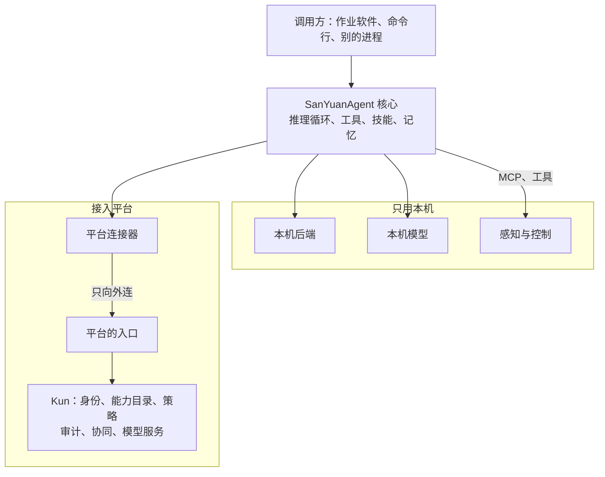

# 独立运行的 SDK

> 状态：规划稿（2026-11-17）。已定的是第 1 节的几句话，其余是提议，待产品负责人确认。「已有」指已经实现：核心的部分在本仓库的 `packages/core`，服务层的部分还在原仓库。

## 1 已定

产品负责人 2026-11-17 的裁定：

1. SanYuanAgent 是一个独立运行的 SDK。
2. 每个端都要用到它，包括机器人这类边缘设备。
3. 装上就能用。

同一天还定了两句和模型有关的话：模型服务由 Kun 提供；机器人本地可能还有小模型。

这几句话带出三个问题，各有一份文档：

| 问题 | 文档 |
|---|---|
| 「独立运行」「装上就能用」落到引擎上是什么 | 本文 |
| 独立运行的引擎怎么接入平台，与 Kun 怎么往来 | [接入平台：与 Kun 的交互](platform.md) |
| 平台的模型服务与设备上的小模型怎么一起用 | [与模型服务的交互](models.md) |

## 2 「装上就能用」的判据

提议用四条来检验：

| 判据 | 含义 |
|---|---|
| 一条命令装好 | 装一个发行包，就同时得到库和命令行。不需要先部署数据库、消息队列，也不需要先部署平台 |
| 只要一个模型端点 | 最小配置只有一项：一个能用的模型端点。它在云上、在厂内机房、在设备本机都可以 |
| 状态都在本机 | 配置、技能、记忆、运行记录缺省落在本机的一个目录里，不依赖外部服务 |
| 接入平台是加法 | 不接平台能完整运行。接入平台只多一步入网，Agent 的写法和用法不变 |

## 3 四种用法

| 用法 | 形式 | 用在哪里 |
|---|---|---|
| 库 | 在自己的 Python 程序里引入：声明一个 Agent，运行它，订阅它的事件 | 嵌进别的应用，比如机器人的作业软件 |
| 命令行 | 一条命令跑一次任务，或者进入对话；可以输出机器可读的事件 | 开发、调试、脚本、流水线 |
| 本机常驻进程 | 作为设备上的一个服务运行。别的进程经本机通道提交任务、订阅事件流、回答确认请求，用什么语言写都可以 | 机器人与工控机，那里的感知与控制一侧通常不是 Python 写的；桌面应用 |
| 集群服务 | 多租户的服务层，按负载伸缩 | 云上；也给没有本机算力的端代为运行 |

四种用法背后是同一个核心：同一份 Agent 声明，同一套事件流。在设备上调通的 Agent，放进集群不用重写。

本机通道提议给两种：标准输入输出上的逐行消息，适合被别的进程拉起来用；本机回环地址上的 HTTP 接口加事件流，适合常驻。两种缺省都只对本机开放。

## 4 两种运行方式

引擎与外界打交道的地方收成一组端口。每个端口有两套实现：一套只用本机，一套接 Kun。

| 端口 | 独立运行 | 接入平台 |
|---|---|---|
| 身份 | 本机身份，没有租户，也没有委托链 | `agent` 主体，用 Kun 签发的短期令牌，带委托链 |
| 工具与能力 | 内置工具，本机的 MCP 服务器 | 再加上 Kun 能力目录里按范围可用的能力 |
| 技能、子 Agent、钩子 | 本机目录里的文件 | 从平台的插件树按范围取，本机校验后缓存 |
| 策略 | 本机配置的工具策略 | 平台能力以 Kun 的判定为准；本机动作用平台下发的策略 |
| 人的确认 | 由调用方回答：命令行里问人，库里走回调 | 交给 Kun 的审核流程 |
| 模型 | 配置里写的端点 | Kun 的模型服务给的目录与路由策略；本机模型是其中一个来源 |
| 审计与用量 | 写本机记录 | 上报 Kun；断网时先存本机，联网后补传 |
| 协同消息 | 没有 | 经 Kun 的信箱收发 |
| 记忆 | 本机 | 本机；要不要同步到平台，待定 |

独立运行是缺省。接入平台之后，平台管的事以平台为准：本机配置可以收得更紧，不能放得更宽。

## 5 本机上有什么

提议：

- **一个目录装下全部状态。** 配置、Agent 声明、技能、记忆、运行记录、等着补传的队列都在一个目录下。整个目录可以备份、迁移、清空。
- **记忆有本机后端。** 四层记忆在设备上不依赖数据库服务：情节与长期记忆落在本机文件里。检索先用关键词与时间，有本机嵌入模型时再开向量检索。
- **技能照旧要可信。** 本机目录里的自定义技能同样要过签名校验。
- **沙箱按设备的能力选。** 设备上能隔离到什么程度随系统而定。做不到隔离的设备上，终端与文件类工具缺省关闭。

## 6 分层与发行物

现有的三层（核心、服务层、媒体适配层）不变。核心内部再分「最小安装」与「按需附加」：

| 部分 | 内容 | 谁需要 |
|---|---|---|
| 最小安装 | 推理循环、工具注册表、技能、记忆的本机后端、模型供应方、事件流、命令行、本机常驻进程、平台连接器 | 所有端 |
| 按需附加 | 浏览器工具、网页检索、文档入库、数据库与向量后端、消息队列、可观测的导出器、媒体适配 | 用到的端各自加装 |
| 服务层 | 多租户的对外服务接口 | 云上 |

- 平台连接器随最小安装发行，只依赖 HTTP 客户端。没有入网时它不起作用。
- 最小安装的依赖越少越好。设备上的存储、内存和联网条件都有限，装不上就谈不上用。
- 面向的系统：Linux（x86-64 与 ARM64）、macOS、Windows。机器人与工控机多是 Linux。现在的发行物是桌面端的自包含构建和服务层的镜像，没有面向 Linux 设备的。

## 7 与设备一侧怎么接

在工站上，引擎是作业智能体：分解工单、编排技能，根据作业结果调整计划。它不做实时控制。

- 设备的技能（抓取、焊接、移载这类）以工具的形式交给引擎。提议统一经 MCP 接入：控制一侧起一个 MCP 服务器，引擎是客户端。
- 引擎给出的是「做哪个技能、带什么参数」。运动约束的校验、轨迹、伺服与急停都在控制一侧，不经过引擎，也不等引擎。
- 感知与动作生成的模型不由引擎的推理循环直接调用，它们的结果以工具结果或事件的形式进入引擎。这类模型算不算在引擎的范围里，仍然待定。

## 8 一个 Agent 怎么到设备上

提议。一个 Agent 的定义是声明加技能，按平台的插件模型打成一个组件：

1. **写。** 在开发机上用库或命令行写出 Agent 的声明与技能，独立运行着调试。
2. **评。** 发布之前先评测。评什么、拿什么数据评、过不过由谁定，待定。
3. **发。** 作为组件发布到平台的目录，带版本与签名。
4. **装。** 设备入网之后，按它的范围从平台取到这个组件，校验后装到本机。
5. **看。** 运行记录、用量与人的反馈回到平台。
6. **改。** 按反馈改声明与技能，发新版本；出了问题可以退回上一版。

不接平台时只有第 1 步：声明与技能直接放在本机目录里。

## 9 现状与差距

已有：

- 核心与服务层分开。核心不引用服务层、可以单独装上，这两条有检查守着。检查的是装得上、命令行起得来，不包括跑通一个 Agent。
- 一个 Agent 用一份声明来描述，可以从声明文件装载。
- 模型供应方可以指到任意兼容的端点，包括本机地址上的。
- 桌面端有本机运行的形态：受限的本机沙箱，以及一条经标准输入输出跑一次任务的通道。
- MCP 的客户端，以及把外部工具接进工具注册表的桥。

离「装上就能用」还差：

| 差距 | 说明 |
|---|---|
| 入口 | 命令行里「按声明运行一个 Agent」的入口还没有做完；对外的编程接口没有定型 |
| 依赖 | 核心把并非每个端都用得上的依赖也列成了必装：数据库、缓存、消息队列的客户端，浏览器自动化 |
| 本机状态 | 情节与长期记忆只有数据库后端，没有本机文件后端 |
| 发布 | 核心还没有作为包发布过。现有的发行物是桌面端的自包含构建（macOS、Windows）和服务层的镜像，没有面向 Linux 设备的 |
| 平台连接 | 与平台的对接基本都写在服务层里，核心里只有产物上传一处。没有统一的连接器 |
| MCP | 客户端还没有接进运行路径；传输只有本地进程一种，接不了远程的 MCP 服务器 |
| 断网 | 没有面向断网的补传。审计、用量、任务回执都是按在线来做的 |
| 本机常驻 | 没有常驻的本机服务。现有的本机通道一次只跑一个任务，功能也不完整 |

这张表只列离「装上就能用」的差距。对照成熟的智能体框架，核心还缺哪些能力、提议怎么补，见[核心的差距与提议](core-gaps.md)。

## 10 待定

| 事项 | 提议 |
|---|---|
| 最小安装包含哪些部分 | 按第 6 节划分 |
| 目标设备的下限 | 能跑 Linux 的设备：工控机、边缘计算盒、机器人的主控计算机。不面向单片机。内存与存储的下限等有了最小安装再实测 |
| 要不要出不依赖本机 Python 的自包含发行物和离线安装包 | 要。设备上未必有合适的 Python，也未必能联网装包 |
| 本机通道的协议 | 写成一份契约，和事件流的契约放在一起。别的语言按契约接，先不出各语言的客户端库 |
| 发行包与命令行的名字 | 见[迁移与改名](migration.md) |
| 引擎自身在设备上怎么升级 | 没有提议。技能与 Agent 定义走平台的组件分发；引擎本身的升级更像设备运维的事 |
| 做不到隔离的设备上，终端与文件类工具是否缺省关闭 | 关闭 |
| 评测怎么做 | 最小形态的提议见[核心的差距与提议](core-gaps.md)第 3.8 节。拿什么数据评、过不过由谁定，仍然没有提议，见第 8 节 |
| 最小可用的独立 SDK 排在路线的哪个阶段 | 迁入之后的第一个对外版本就按这个形态发；与 Kun 的对接等 `agent` 主体启用之后做。平台的路线把主体排在里程碑 M1，设备接入排在 M8（已定，见平台总览的[路线与迁移](https://github.com/CavaiLAB/jiangxin/blob/main/docs/06-roadmap.md)第 2.1 节） |
